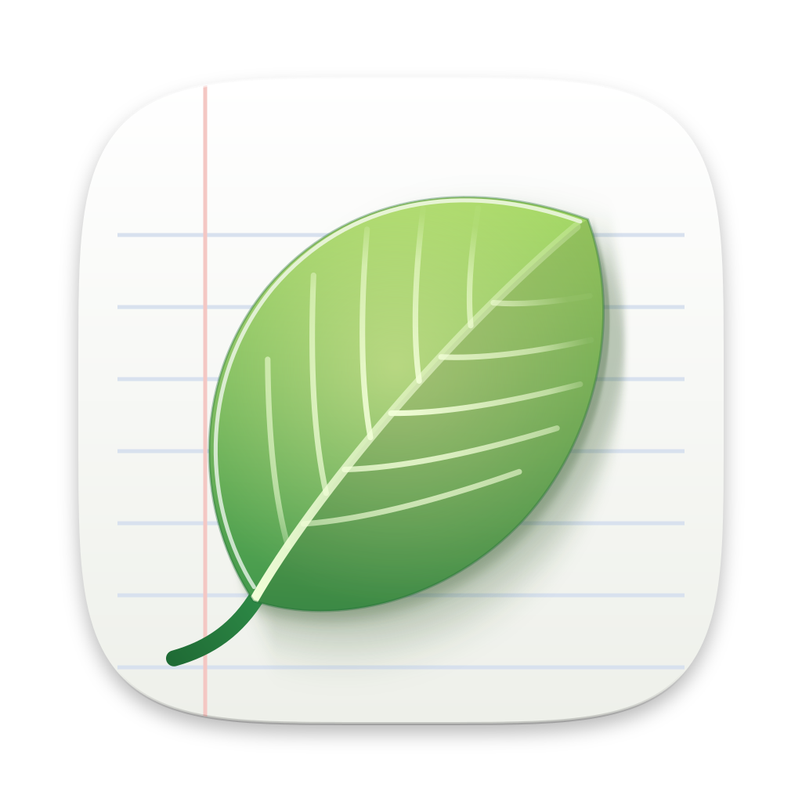

<p align="center">
  
</p>

<h1 align="center">Leaflet</h1>

<p align="center">
  人と AI エージェントが一緒に「生きたドキュメント」を書く、ネイティブのデスクトップアプリ。
</p>

<p align="center">
  <a href="https://github.com/tacshi/Leaflet/releases/latest"></a>
  <a href="LICENSE"></a>
  <a href="#動作環境"></a>
  <a href="#動作環境"></a>
  <a href="#ios"></a>
  <a href="https://go.dev"></a>
  <a href="#アプリ外のエージェント-mcp"></a>
  <a href="https://github.com/egoist/mygo"></a>
  <a href="https://awesomemygo.dev/apps/leaflet"></a>
</p>

<p align="center">
  <a href="README.md">English</a> | <a href="README.zh.md">简体中文</a> | <b>日本語</b>
</p>

Leaflet は、メモや仕様書、議事録をブロックでできたページとして保存し、AI
エージェントがあなたの隣でそこに書き込めるようにします。行内で、選択範囲から、
チャットで、あるいはコメントスレッドで頼むと、エージェントはページを読み、
検証済みのツールで編集します。その編集は 1 回の操作として取り消せます。ページは
まずデバイスに保存され、iCloud Drive を通じて、またはサインインすると Leaflet サーバーを通じて同期されるので、Leaflet はオフラインでも、
ローカルモデルでも使えます。

Leaflet は Go と [MyGo](https://github.com/egoist/mygo) で書かれています。MyGo
はインターフェイス全体を GPU でネイティブに描画し、アプリ自体には Web
ビューを使いません。

## 目次

- [機能](#機能)
- [動作環境](#動作環境)
- [インストール](#インストール)
- [ソースから実行](#ソースから実行)
- [アプリ外のエージェント (MCP)](#アプリ外のエージェント-mcp)
- [コマンドライン](#コマンドライン)
- [ビルドとリリース](#ビルドとリリース)
- [開発](#開発)
- [プロジェクト構成](#プロジェクト構成)
- [既知の制限](#既知の制限)
- [謝辞](#謝辞)
- [ライセンス](#ライセンス)

## 機能

### 書く

- Leaflet 独自のブロックエディタ：見出し、入れ子のリスト、期日付きの ToDo、
  引用、コールアウト、トグル、表、シンタックスハイライト付きのコード、数式、
  ダイアグラム、グラフ、画像、ファイル、動画、リンクカード、サンドボックス内で
  動くインタラクティブな埋め込み。
- Markdown のショートカット、`/` メニュー、メンバー・エージェント・ページへの
  `@` メンション、文字色を変えられる選択ツールバー、折りたためる見出し、
  アウトライン、ページや個々のブロックへのリンク。
- YouTube、Vimeo、Bilibili、Dailymotion、ニコニコの動画や動画ファイルを
  ページ内で再生し、それぞれの下に動画の概要欄のようなメモを置けます：
  メモの時刻をクリックすると、その動画をそこから再生します。動画や録音の
  ある場面へのリンクは、どのページやチャットからでもその場面から再生します。
- 入れ子のページとフォルダ、テンプレート、ページの複製、検索、Markdown と PDF
  への書き出し。
- 名前付きバージョンを持つページ履歴と、任意のバージョンからの変更点の表示
  （インラインまたは左右に並べて）。

### エージェントと働く

- `@agent` で、行内、選択範囲、サイドチャット、コメントスレッドからエージェント
  に頼めます。
- すべての編集は検証済みのツール呼び出し（`read_page`、`write_markdown`、
  `insert_blocks`、`replace_block`、`move_block`、`delete_blocks`、
  `create_subpage`、`create_page`、ほかのページの読み取りがオンなら
  `list_pages`、`read_other_page`、`list_folders` も）で、履歴のスナップ
  ショットを取ってからページにストリーミングされ、1 回の取り消し単位に
  なります。
- 新しいページを頼むと、エージェントは独立したページをトップレベルか
  フォルダに作り（`create_page`）、そのページの中にと頼めばサブページを
  作ってページの最後にリンクを置きます（`create_subpage`）。ほかの人が
  書き込む、ゲストがコメントする、または公開リンクで読まれるページでは
  サブページを作ります。自分のページを作ると、その人たちの書いたものが
  自分のページに入ってしまうからです。
- ワークスペースエージェントは 1 ページではなくすべてのページを扱います。
  パネルの「エージェント」タブで「すべてのページ」を選ぶか、ページを開いて
  いないときのパネルで使えます。ページを探して読み、作成、移動、名前の変更、
  タグ付け、フォルダの作成ができ、どの変更も取り消せます。ほかの人と共有
  しているページは変更せず、ほかの人も書き込むページは読みません。
- エージェントは YouTube と Vimeo の動画で話されている内容を字幕から読み
  （`read_video_transcript`）、場面ごとの時刻付きで動画のメモを書き、動画や
  録音のある場面をリンクで示せます。
- 許可すれば、エージェントはウェブを使えます：`read_web_page` はページを
  リンク付きのテキストとして読み、`web_search` はエージェント自身のプロバイダ
  （OpenAI、Claude、xAI、OpenRouter、GLM、ChatGPT プラン）で検索します。
  ウェブを読んだ実行は、見つけたリンクかあなたが渡したリンクだけを書き込み、
  読みます。ほかのページを読んだ実行は、それ以降ウェブを使いません。
- OpenAI 互換のプロバイダならどれでも使えます：OpenAI、Claude、xAI、
  OpenRouter、DeepSeek、GLM のプリセット、ChatGPT Plus / Pro でのサインイン、
  カスタムエンドポイント、そしてオフラインでエージェントを動かせる Ollama、
  LM Studio、llama.cpp、vLLM などのローカルサーバー。
- Claude Code、Codex、Cursor などアプリ外のエージェントも
  [`leaflet mcp`](#アプリ外のエージェント-mcp) を通じてページを扱えます。
- [`leaflet` コマンド](#コマンドライン)で、ターミナルやスクリプトからページの
  検索、閲覧、作成、整理、追記ができます。

### 録音

- 再生とタイムスタンプ付きの文字起こしを備えた録音ブロック。
- Soniox、または自分のネットワーク内のものを含む任意の OpenAI 互換
  `/audio/transcriptions` エンドポイントによるリアルタイム文字起こし。
- システム自身の音声認識による、デバイス上での文字起こし（オフライン、キー
  不要）：macOS 26 以降の Mac と、iPhone と iPad で使えます。

### 共有と同期

- ブロックに紐づくコメントスレッドと、Mac と PC で Leaflet を開いている間、
  リンクを知っている人全員、または指定したアドレスの人だけにページを見せる
  一時的な公開リンク。サーバーは閲覧者・編集者とのページ共有（サブページに
  継承されます）にも対応していますが、まだどのアプリからも使えません。
- オフラインファースト：すべて SQLite に保存され、オンラインになると送信トレイ
  を通じて同期されます。別々に行われた編集はブロック単位でマージされ、競合が
  あれば通知とともにもう一方のバージョンを戻す手段が示されます。Leaflet
  サーバーを通じて同期していれば、開いているページには、別のデバイスでの変更
  （そこでエージェントが書いている内容など）が保存されたそばから Supabase
  Realtime を通じて表示されます。
- iCloud 同期：Mac や PC が iCloud Drive の Leaflet フォルダを通じて同期
  します。サーバーもサインインも不要です。「設定 › 同期とストレージ」で
  オンにします。Windows では iCloud for Windows が必要です。
- ToDo のリマインダー、メニューバーのアイコン、ライトとダークのテーマ、
  GitHub Releases からのアップデート。
- 英語・簡体字中国語・日本語に対応：Leaflet はシステムの言語に従うほか、
  設定 › 外観 で選ぶこともできます。ウェルカムガイドは初回起動時の言語で
  作成されます。

## 動作環境

- macOS 13 以降（Apple シリコンまたは Intel）、または x64 / arm64 の Windows。
- ソースからビルドするには Go 1.27.3 以降。Go のコードに cgo や C
  コンパイラは不要です。Mac アプリのオンデバイス音声認識ヘルパー
  （[`speech`](speech)）は Swift で書かれ、`scripts/build-speech.sh`
  が Xcode 26 以降（macOS 26 SDK）でビルドします。Xcode でビルドできない環境
  では、デバッグビルドはヘルパーなしで続行し、リリースビルドには必須です
  （署名と公証にも Xcode が必要です）。Windows インストーラには NSIS が
  必要です。
- iCloud 同期には iCloud Drive をオンにしておく必要があります。
- サーバー経由の同期とクラウドモデルには [Supabase](https://supabase.com)
  のアカウントが必要です：**Supabase で続ける** がその中のプロジェクトを見つけるか作成し、
  [`supabase/`](supabase/README.md) の内容で設定します。アカウントがなければ、
  Leaflet はデバイス上だけで動作します。

## インストール

[最新リリース](https://github.com/tacshi/Leaflet/releases/latest)から macOS
用のディスクイメージ、または Windows 用のインストーラをダウンロードしてください。
インストールしたアプリは GitHub Releases から自動でアップデートされます。
Windows インストーラはまだコード署名されていないため、初回の実行時に SmartScreen
が警告することがあります。

## ソースから実行

```bash
git clone https://github.com/tacshi/Leaflet.git
cd Leaflet
go tool mygo dev
```

サーバーがない場合、Leaflet はこのデバイスだけで動作します。ページ、編集、
コメント、公開リンク、ローカルモデル、ネットワーク内の文字起こしサーバーは
すべて使え、サインイン、同期、クラウドモデル、クラウドの文字起こしは非表示になるか、
その場で理由が説明されます。

どのビルドでも Supabase でサインインできます。OAuth アプリのクライアント ID は組み込まれ、
シークレットは Leaflet のサインイン用 Worker が保持しています（[`supabase/README.md`](supabase/README.md) を参照）。

ローカルスタックなど特定のサーバーを使う場合は、それを指定し、メールで届くコードでサインインします：

```bash
SUPABASE_URL=http://127.0.0.1:54321 SUPABASE_PUBLISHABLE_KEY=<publishable key> go tool mygo dev
```

API キーなしでエージェントを試すには、ローカルのモデルサーバー（たとえば
`ollama serve` と `qwen3:8b`）を動かし、設定 › エージェントプロバイダ で追加します。

`go tool mygo dev` で Mac 自身による文字起こしを使うには、先に
`scripts/build-speech.sh` で音声認識ヘルパーをビルドします（Xcode 26 以降が
必要です）。

### iOS

iPhone と iPad のアプリは [`ios/`](ios) にあり、開発中です。デスクトップ
アプリと同じ Go のコアをリンクし、gomobile が [`mobile`](mobile) パッケージ
を通じて Swift にバインドします。Xcode 27 と
[XcodeGen](https://github.com/yonaskolb/XcodeGen) が必要です：

```bash
make ios-core     # Go のコア：ios/build/LeafletCore.xcframework
make ios-project  # ios/project.yml から ios/Leaflet.xcodeproj を生成
make ios-test     # iPhone と iPad のシミュレータでアプリのテストを実行
```

そのあと `ios/Leaflet.xcodeproj` を開きます。実機で動かすには、git が無視する
`ios/Config/Local.xcconfig` にチームを設定します：
`DEVELOPMENT_TEAM = <チーム ID>`。

`scripts/publish_testflight.sh <バージョン> <ビルド>` は App Store 用にアプリ
をビルドし、TestFlight の内部グループに公開します。App Store Connect に
サインインした [asc](https://asccli.sh) が必要です。
必要なものは `--help` で説明しています。

### データ

Leaflet はデータベースをアプリのデータフォルダ（macOS では
`~/Library/Application Support/Leaflet` など）、または `LEAFLET_DATA_DIR`
で指定したフォルダに保存します。

## アプリ外のエージェント (MCP)

`leaflet mcp` は stdio で動く [Model Context Protocol](https://modelcontextprotocol.io)
サーバーで、Claude Code、Claude Desktop、Codex、Cursor、VS Code などの
クライアントから使えます。設定 › 外部エージェント に、このアプリの実行ファイルと
データフォルダを埋め込んだ各クライアント向けの設定方法があります。Claude Code
の場合：

```bash
claude mcp add -s user leaflet -e LEAFLET_DATA_DIR=<データフォルダ> -- <実行ファイル> mcp
```

| ツール | 内容 |
| --- | --- |
| `list_pages`、`search_pages` | タイトル、タグ、本文でページを、また録音やコメントを探す |
| `current_page` | アプリで開いているページと、選択中のテキストとその文字色を見る |
| `read_page` | ページのブロックを ID 付きで読む |
| `create_page`、`rename_page` | ページの作成と名前の変更 |
| `set_page_tags` | ページのタグを設定する |
| `move_page` | ページをフォルダや別のページの中、またはトップレベルへ移動する |
| `create_folder`、`rename_folder` | フォルダの作成と名前の変更 |
| `write_markdown`、`insert_blocks`、`replace_block`、`move_block`、`delete_blocks` | アプリ内のエージェントと同じようにページを編集する |

このサーバーはアプリと同じデータベースを開くので、アプリが開いていても閉じて
いても動作します。閲覧のみで共有されたページは読み取り専用です。エージェントが
あるページを初めて編集する前に履歴のスナップショットを 1 つ保存し、その後は
編集 10 分ごとに 1 つ保存し、ほかの変更と同じように同期します。開いている
アプリは 1 秒以内にその内容を取り込み、入力中の内容とマージします。アプリが
閉じているかページが開いていないとき、`current_page` はこのデバイスで最後に
開いたページを返し、選択範囲は含みません。

エージェントはテキストフィールドで文字色とハイライトを
`<span style="color:#ef4444;background:#fde68a">テキスト</span>` のように 16 進数で
読み書きします。`leaflet cat` とエクスポートには色は含まれません。

開発ビルドで試すには、開発版アプリのデータフォルダをバイナリに渡します：

```bash
go build -o leaflet . && claude mcp add -s user leaflet -e LEAFLET_DATA_DIR="$HOME/Library/Application Support/Leaflet Dev" -- "$PWD/leaflet" mcp
```

## コマンドライン

`leaflet` は `leaflet mcp` と同じツールで、ターミナルからページの検索、閲覧、
作成、整理、追記ができます：

| コマンド | 内容 |
| --- | --- |
| `leaflet ls` | フォルダとページを ID とタグ付きで一覧する |
| `leaflet search QUERY` | タイトル、タグ、本文でページを、また録音やコメントを探す |
| `leaflet current` | アプリで開いているページと、選択中のテキストとその文字色を表示する |
| `leaflet cat PAGE` | ページを Markdown で出力する |
| `leaflet new [TITLE]` | ページを作成し、その ID を出力する。`--stdin` でパイプで渡した Markdown を内容にする |
| `leaflet append PAGE [TEXT...]` | ページの末尾に Markdown を追加する：指定した文字列、またはパイプで渡した内容 |
| `leaflet rename PAGE TITLE` | ページのタイトルを変更する |
| `leaflet mv PAGE --in PAGE \| --folder FOLDER \| --top` | ページを別のページの中、フォルダ、またはトップレベルへ移動する |
| `leaflet tag PAGE [TAG...]` | ページのタグを設定する、または出力する。`--clear` ですべて外す |
| `leaflet folder new NAME`、`leaflet folder rename FOLDER NAME` | フォルダの作成と名前の変更 |

ページはタイトル、ID、または `ls` が表示する ID の先頭部分で指定できます。
`--json` は MCP ツールが返す内容を出力し、`leaflet completion zsh`（または bash、
fish、powershell）はページのタイトルを補完する補完スクリプトを書き出します。

```bash
make test 2>&1 | leaflet append "CI log"
leaflet new "Meeting notes" --folder Work --stdin < notes.md
leaflet cat Roadmap > roadmap.md
```

設定 › 外部エージェント › コマンドライン からインストールできます。Mac では
`/usr/local/bin` にアプリへのリンクを作り、そのフォルダに管理者権限が必要な
ときは管理者のパスワードを求めます。Windows では、コンソールプログラム
`leaflet.exe` が入ったアプリの隣の `bin` フォルダを Path に追加し、その後に
開いたターミナルから使えます。`leaflet mcp` と同じく、アプリが開いていても
閉じていてもこのデバイスのデータベースに書き込みます。開いているアプリは 1 秒
以内に変更を表示し、アプリの実行中に同期します。各ページの履歴には変更前の
バージョンが残ります。

開発ビルドで試すには、アプリを実行したことのあるデータフォルダをバイナリに渡します：

```bash
go build -o leaflet . && LEAFLET_DATA_DIR="$HOME/Library/Application Support/Leaflet Dev" ./leaflet ls
```

## ビルドとリリース

`go tool mygo build` はアプリを `build/` にビルドします。リリース用スクリプトは、
`--mac` か `--win` でどちらかを選ばない限り macOS と Windows の両方に向けて
ビルドします。デバッグ用スクリプトは macOS 向けに、`--win` を付けると Windows
向けにビルドします：

| スクリプト | ビルドするもの |
| --- | --- |
| `scripts/build-debug.sh [--mac\|--win] [--open]` | Leaflet Debug という名前のデバッグビルド。独自の識別子とデータフォルダを持ち、自動アップデートしないため、リリース版と並べて動かせます |
| `scripts/build-release.sh [--mac] [--win] [<version>]` | 署名・公証済みの Apple シリコン用、Intel 用、ユニバーサルのディスクイメージと、Windows x64 / arm64 用インストーラ、署名付きのアップデートアーカイブ |
| `scripts/publish.sh <version> [--mac\|--win] [--allow-partial] [--dry-run]` | macOS と Windows の GitHub リリース：チェック、`CHANGELOG.md` からのリリースノート、ビルド、タグ付け、公開。片方だけ指定すると、もう片方のビルドが加わるまでドラフトのままです。プラットフォームのアップデートマニフェストがないリリースでは、そのインストール済みアプリにアップデートが届かないためです。`--allow-partial` を付けるとそのまま公開します |

Windows では、PowerShell 7 のスクリプトがそのマシン上で Windows アプリを
ビルドします。NSIS がインストールされていなければ MyGo がダウンロードし、
署名には Windows SDK の `signtool` を使います：

| スクリプト | ビルドするもの |
| --- | --- |
| `scripts\build-debug.ps1 [-Arch arm64\|x64] [-Open]` | `build-debug.sh --win` と同じく Leaflet Debug |
| `scripts\build-release.ps1 [<version>] [-Arch …] [-Upload]` | `build-release.sh --win` と同じく、x64 と arm64 のインストーラと署名付きのアップデートアーカイブ |

どのスクリプトも `--help` で、`.ps1` のものは `Get-Help` でオプションを表示
します。macOS のリリースには Developer ID Application の証明書と
`notarytool` のキーチェーンプロファイル、Windows インストーラには NSIS
（`brew install makensis`）、すべてのリリースにはアップデート署名鍵が必要です。
それぞれ `scripts/build-release.sh --help` で説明しています。署名されていない
Windows インストーラや `--skip-notarize` でビルドした macOS のものは、
`--allow-unsigned`（`-AllowUnsigned`）か `LEAFLET_ALLOW_UNSIGNED=1` で
公開すると明示しない限りアップロードされません。

`SUPABASE_URL` と `SUPABASE_PUBLISHABLE_KEY` が 1 回の実行にサーバーを指定するように、
ビルドにサーバーを 1 つ組み込むには、その URL と Publishable キーを
`MYGO_LDFLAGS` でリンカに渡します。`go tool mygo build` とスクリプトはこれを
そのまま渡します：

```bash
MYGO_LDFLAGS="-X leaflet/internal/remote.DefaultURL=https://<ref>.supabase.co -X leaflet/internal/remote.DefaultPublishableKey=<publishable key>" scripts/build-release.sh
```

## 開発

```bash
go test ./...                                # モデル、マージ、ストア、同期、エディタ、エージェント
make check                                   # gofmt、golangci-lint、govulncheck、gosec
make ios-check                               # swift-format、SwiftLint、osv-scanner、mobsfscan
make clean                                   # build/ と go build が残すバイナリを削除
scripts/check-migrations.sh                  # すべてのマイグレーションを順に Supabase の Postgres に適用（Docker）
cd supabase/functions && deno test _shared/  # Edge Functions の共有コード
```

エディタのテストは `ui.NewTester` でビューをヘッドレスに動かします。

アプリのテキストは [`locales/`](locales) にある MyGo のカタログで、言語ごとに
1 ファイル（`en.json`、`zh-Hans.json`、`ja.json`）です。`go tool mygo dev`
と `go tool mygo build` がここから `locales/catalog_gen.go` を生成するので、
カタログと一緒にコミットしてください。`go tool mygo i18n check` でカタログを
検査でき、`go tool mygo dev -lang ja` を使うと、保存されている言語を変えずに
別の言語でアプリを起動できます。言語を追加するには、BCP 47 タグを名前にした
カタログを追加します。
[`docs/protocol.md`](docs/protocol.md) はアプリとバックエンドの取り決めです：
ドキュメント形式、エージェントのツール、保存と同期のルール。

## プロジェクト構成

| パス | 内容 |
| --- | --- |
| `main.go` | エントリポイント：アプリと、`leaflet mcp` を含むコマンドライン |
| `cmd/leaflet` | Windows のコマンドライン：アプリの隣のコンソールプログラム `bin\leaflet.exe` |
| `mobile` | iOS アプリ向けの Go コアの API。gomobile で Swift にバインドされます |
| `internal/core` | Leaflet の各部分を開いてつなぐ処理（デスクトップと iOS のアプリで共通）、サインインとサインアウト |
| `internal/live` | アプリで開いているページ：入力内容の保存と、その間に同期やエージェントから届いた内容のマージ |
| `internal/app` | ウィンドウ、シェル、サイドバー、ページ画面、パネル、ダイアログ、設定 |
| `internal/editor` | ブロックエディタ：モデル、編集、レイアウト、入力、ブロック |
| `internal/doc` | ページのドキュメントモデル：ブロック、差分、インライン Markdown、操作、ブロック単位のマージ、Markdown 書き出し |
| `internal/menu`、`internal/shortcut` | `/` と `@` のメニューの項目と、ページで入力した Markdown の変換（両アプリのエディタで共通） |
| `internal/rendered` | 数式（KaTeX）とダイアグラム（Pele）を描画するページ。ネットワークのないフレームで動きます |
| `internal/webpage` | 単独で開けるウェブページとしてのページ。公開リンクで共有し、書き出し › PDF で印刷するもので、両方のアプリで使います |
| `internal/starters` | Leaflet に付属するテンプレート |
| `internal/export` | すべてのページを、画像、ファイル、録音とともに Markdown の zip に書き出す |
| `internal/web` | リンクカード、画像、動画の情報と字幕、エージェントが読むページを、公開アドレスからだけ読み込む |
| `internal/store` | SQLite（純 Go）のテーブル、送信トレイ、設定 |
| `internal/remote` | HTTP 経由の Supabase：Auth、PostgREST、Storage、Edge Functions |
| `internal/sync` | 送信トレイのプッシュ、プル、アカウントの引き継ぎ、デバイスのハートビート（Supabase または iCloud Drive 経由） |
| `internal/supabaseapi` | 本人の Supabase アカウントでサインインする Supabase Management API |
| `internal/provision` | 本人の Leaflet プロジェクトの検索、作成、設定：マイグレーションと Edge Functions |
| `internal/oauth` | ブラウザでのサインインのうちこのデバイス側の部分：ループバックのリダイレクトと PKCE |
| `internal/icloud` | iCloud Drive の Leaflet フォルダ：まるごと書き込むファイルと、iCloud へのダウンロードの依頼 |
| `internal/keychain` | システムのキーチェーンにあるアプリのシークレット。1 回の起動で読むのは多くても 1 度 |
| `internal/agents` | OpenAI 互換クライアント、プリセット、プロンプト、ページツール、ループ、ハブ |
| `internal/mcp` | `leaflet mcp`：アプリ外のエージェント向けページツール |
| `internal/cli` | それらのツールを使う `leaflet` コマンドライン |
| `internal/recording` | キャプチャ、WAV、Soniox ストリーミング、エンドポイントでの文字起こし |
| `internal/macspeech`、`speech` | デバイス自身の音声認識による文字起こし。`speech` は Swift パッケージで、iOS アプリと、Mac アプリに同梱するヘルパー `leaflet-speech` がこれでビルドされます |
| `internal/theme` | 色、フォント、アイコン |
| `locales` | 各言語のアプリのテキストと、そこから生成される Go コード |
| `scripts` | デバッグビルドとリリースビルド、GitHub Releases への公開、マイグレーションの検査 |
| `supabase` | マイグレーション（テーブル、行レベルセキュリティ、RPC、Vault）と Edge Functions |
| `worker` | Cloudflare 上のサインイン用 Worker：OAuth のリダイレクトページと、クライアントシークレットを持つトークン交換 |
| `docs` | プロトコル、ユーザーストーリー、アイコンのソース |
| `ios` | iPhone と iPad のアプリ：SwiftUI と UIKit、その XcodeGen プロジェクトとビルドスクリプト |

マイクのキャプチャは、アプリ独自の `leaflet-rec://` スキーム上の小さなページで
動きます。これはシステムの Web ビューがマイクの使用を許すセキュアコンテキストな
ので、音声のキャプチャにネイティブのコードは要りません。埋め込み、数式、
ダイアグラムはネットワークを許さないコンテンツセキュリティポリシーの下、
サンドボックス化されたフレームで動き、アプリの Go コードを呼び出すことは
できません。このポリシーが対象としない WebRTC は、Web ビューが CSP の
`webrtc` ディレクティブを理解する場合はそれで遮断し、そうでない場合は埋め込みの
スクリプトが動く前にフレームから取り除きます（できる限りにおいて）。

## 既知の制限

- リアルタイムの共同編集は未実装です：ページはブロック単位で同期・マージされます。
- オープンなモデルによるオンデバイスの音声認識（Qwen3-ASR、sherpa-onnx 経由の
  SenseVoice）は、sherpa-onnx がネイティブライブラリを必要とするため移植して
  いません。代わりに、macOS 26 以降の Mac と iPhone、iPad では、システム自身の
  音声認識がデバイス上で文字起こしします。Windows と古い Mac では、ネットワーク
  内の OpenAI 互換エンドポイントでモデルを提供してください。
  MOSS-Transcribe-Diarize も同様です。
- サードパーティアプリでの Claude のアカウントによるサインインは確認できて
  いないため、Claude は API キーを使います。OpenAI も API キーを使うか、
  ChatGPT Plus / Pro でサインインします。

## 謝辞

Leaflet は [MyGo](https://github.com/egoist/mygo) の上に作られています。
SIL Open Font License の [Figtree](https://github.com/erikdkennedy/figtree)
と [Source Serif 4](https://github.com/adobe-fonts/source-serif)
（`internal/theme/fonts/OFL-*.txt`）、ISC ライセンスの
[Lucide](https://lucide.dev) アイコン（`internal/theme/icons/LICENSE`）、
数式とダイアグラムのための MIT ライセンスの [KaTeX](https://katex.org) と
[Pele](https://github.com/obsidianmd/pele)
（[`internal/rendered/third_party`](internal/rendered/third_party/README.md)）を同梱
しています。

## ライセンス

Leaflet は [MIT ライセンス](LICENSE)で公開されています。同梱しているフォント、
アイコン、ライブラリはそれぞれのライセンスに従います（[謝辞](#謝辞)を参照）。
