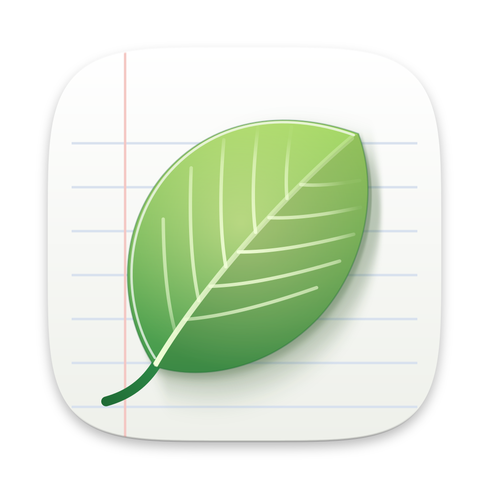

<p align="center">
  
</p>

<h1 align="center">Leaflet</h1>

<p align="center">
  一款原生桌面应用，让人与 AI 智能体一起书写活文档。
</p>

<p align="center">
  <a href="https://github.com/tacshi/Leaflet/releases/latest"></a>
  <a href="LICENSE"></a>
  <a href="#系统要求"></a>
  <a href="#系统要求"></a>
  <a href="#ios"></a>
  <a href="https://go.dev"></a>
  <a href="#应用外的智能体-mcp"></a>
  <a href="https://github.com/egoist/mygo"></a>
  <a href="https://awesomemygo.dev/apps/leaflet"></a>
</p>

<p align="center">
  <a href="README.md">English</a> | <b>简体中文</b> | <a href="README.ja.md">日本語</a>
</p>

Leaflet 把你的笔记、规格文档和会议记录保存为由块组成的页面，并让 AI
智能体在你身边一起工作。你可以在行内、从选中的文字、在聊天中或在评论串里
向它提问：它会阅读页面，并通过经过校验的工具来编辑页面，整个修改只算一步，
可以一键撤销。页面先保存在你的设备上，再通过 iCloud 云盘同步，或在登录后通过 Leaflet 服务器同步，所以 Leaflet 可以离线
使用，也可以搭配本地模型。

它用 Go 和 [MyGo](https://github.com/egoist/mygo) 编写，MyGo 在 GPU
上原生绘制整个界面，应用本身不使用网页视图。

## 目录

- [功能](#功能)
- [系统要求](#系统要求)
- [安装](#安装)
- [从源码运行](#从源码运行)
- [应用外的智能体 (MCP)](#应用外的智能体-mcp)
- [命令行](#命令行)
- [构建与发布](#构建与发布)
- [开发](#开发)
- [项目结构](#项目结构)
- [已知限制](#已知限制)
- [致谢](#致谢)
- [许可证](#许可证)

## 功能

### 书写

- Leaflet 自己的块编辑器：标题、嵌套列表、带截止日期的待办、引用、标注、
  折叠块、表格、带语法高亮的代码、数学公式、图表与示意图、图片、文件、
  视频、链接卡片，以及在沙盒中运行的交互式嵌入。
- Markdown 快捷输入、`/` 菜单、用 `@` 提及成员、智能体和页面、带文字颜色
  的选区工具栏、可折叠的标题、大纲，以及指向页面和单个块的链接。
- 在页面中播放 YouTube、Vimeo、哔哩哔哩、Dailymotion 和 niconico 的视频或
  视频文件，每个视频下方可以写笔记，就像视频的简介栏：点击笔记中的时间，
  就从那里播放这个视频。指向视频或录音某一刻的链接，在任何页面或聊天中点击，
  都从那一刻开始播放。
- 嵌套页面与文件夹、模板、复制页面、搜索，以及导出为 Markdown 和 PDF。
- 页面历史，支持命名版本，可以行内或并排查看与任一版本相比的改动。

### 与智能体协作

- 用 `@agent` 在行内、从选区、在侧边聊天或在评论串中向智能体提问。
- 每一次编辑都是经过校验的工具调用（`read_page`、`write_markdown`、
  `insert_blocks`、`replace_block`、`move_block`、`delete_blocks`、
  `create_subpage`、`create_page`，开启读取其他页面时还有 `list_pages`、
  `read_other_page` 和 `list_folders`），在保存历史快照后以流式写入页面，
  并合为一步撤销。
- 要一个新页面时，智能体会在顶层或文件夹中建立独立的页面
  （`create_page`）；要求放在当前页面中时，则建立子页面，并在页面末尾放上
  它的链接（`create_subpage`）。在他人也会编辑、访客评论过或通过公开链接
  阅读的页面上，它只建立子页面：建立你自己的页面会把他们写的内容带进你的
  页面。
- 工作区智能体处理你所有的页面，而不是某一个：在面板的“智能体”标签中选择
  “所有页面”，或在没有打开页面时使用面板。它可以查找和阅读页面，新建、移动、
  重命名页面、设置标签以及新建文件夹，每次更改都可撤销，并且不会更改与他人
  共享的页面，也不会阅读他人同样会编辑的页面。
- 智能体可以从字幕读取 YouTube 和 Vimeo 视频中说的内容
  （`read_video_transcript`），写出带每个要点时间的视频笔记，并用链接指出
  视频或录音的某一刻。
- 在你允许时，智能体可以使用网络：`read_web_page` 把网页读成带链接的文本，
  `web_search` 通过智能体自己的服务商搜索（OpenAI、Claude、xAI、OpenRouter、
  GLM 或 ChatGPT 套餐）。一次运行读过网络后，只写入和读取它找到的或你给的
  链接；一旦读取你的其他页面，这次运行就不再使用网络。
- 支持任何兼容 OpenAI 的服务商：内置 OpenAI、Claude、xAI、OpenRouter、
  DeepSeek 和 GLM 预设，支持 ChatGPT Plus 或 Pro 登录、自定义端点，以及
  Ollama、LM Studio、llama.cpp、vLLM 等本地服务，可离线运行智能体。
- 应用外的智能体，例如 Claude Code、Codex 和 Cursor，可以通过
  [`leaflet mcp`](#应用外的智能体-mcp) 处理页面。
- [`leaflet` 命令](#命令行)可以在终端和脚本中查找、阅读、新建和整理页面，并向
  页面添加内容。

### 录音

- 录音块，支持回放和带时间戳的转写文本。
- 使用 Soniox 或任何兼容 OpenAI 的 `/audio/transcriptions` 端点进行实时
  转写，包括你自己网络中的端点。
- 用系统自带的语音识别在设备上转写，离线可用，无需密钥：适用于 macOS 26
  或更高版本的 Mac，以及 iPhone 和 iPad。

### 共享与同步

- 锚定在块上的评论串，以及 Mac 和 PC 上的临时公开链接：在 Leaflet 打开期间，
  把页面分享给任何拿到链接的人，或只分享给你指定的地址。服务器也支持与查看者
  或编辑者共享页面（子页面会继承共享设置），但目前还没有应用提供这一功能。
- 离线优先：所有内容都保存在 SQLite 中，联网后通过发件箱同步。分开进行的
  编辑会按块合并，出现冲突时会给出提示，并可以恢复另一个版本。通过 Leaflet
  服务器同步时，另一台设备对打开的页面所做的改动（比如那里的智能体正在写的
  内容）一保存，就会通过 Supabase Realtime 显示出来。
- iCloud 同步：你的 Mac 和 PC 通过 iCloud 云盘中的 Leaflet 文件夹同步，
  无需服务器，也无需登录。在“设置 › 同步与存储”中打开；Windows 上需要
  iCloud for Windows。
- 待办提醒、菜单栏图标、浅色与深色主题，以及来自 GitHub Releases 的更新。
- 支持英文、简体中文和日文：Leaflet 跟随系统语言，也可以在
  设置 › 外观 中选择；欢迎指南会以首次运行时的语言写成。

## 系统要求

- macOS 13 或更高版本（Apple 芯片或 Intel）；或 x64、arm64 上的 Windows。
- 从源码构建：Go 1.27.3 或更高版本；Go 代码不需要 cgo 或 C 编译器。Mac
  应用的设备端语音识别助手（[`speech`](speech)）用 Swift 编写，
  由 `scripts/build-speech.sh` 使用 Xcode 26 或更高版本（macOS 26 SDK）
  构建：在 Xcode 无法构建它的环境中，调试构建会跳过它继续进行，发布构建则
  必须有它（签名和公证也需要 Xcode）。Windows 安装程序需要 NSIS。
- iCloud 同步需要打开 iCloud 云盘。
- 通过服务器同步和云端模型需要一个 [Supabase](https://supabase.com)
  账户：**使用 Supabase 继续** 会在其中找到或创建一个项目，并按
  [`supabase/`](supabase/README.md) 完成设置。没有账户时，Leaflet 仅在你的设备上运行。

## 安装

从[最新版本](https://github.com/tacshi/Leaflet/releases/latest)下载
macOS 磁盘映像或 Windows 安装程序。安装后的应用会从 GitHub Releases
自动更新。Windows 安装程序目前还没有代码签名，首次运行时 SmartScreen 可能会发出警告。

## 从源码运行

```bash
git clone https://github.com/tacshi/Leaflet.git
cd Leaflet
go tool mygo dev
```

没有服务器时，Leaflet 只在本机运行：页面、编辑、评论、公开链接、本地模型
以及你网络中的转写服务都可以使用；登录、同步、云端模型和云端转写会被隐藏，
或在原处说明原因。

每个版本都可以使用 Supabase 登录：OAuth 应用的客户端 ID 已内置，其密钥保存在
Leaflet 的登录 Worker 中（见 [`supabase/README.md`](supabase/README.md)）。

如果要改用某一台服务器（例如本地栈），设置它，并通过邮件中的验证码登录：

```bash
SUPABASE_URL=http://127.0.0.1:54321 SUPABASE_PUBLISHABLE_KEY=<publishable key> go tool mygo dev
```

想在没有 API 密钥的情况下试用智能体，可以运行一个本地模型服务（例如用
`ollama serve` 运行 `qwen3:8b`），然后在 设置 › 智能体服务商 中添加。

要在 `go tool mygo dev` 下用 Mac 本身转写，先用 `scripts/build-speech.sh`
构建它的语音识别助手，这需要 Xcode 26 或更高版本。

### iOS

iPhone 和 iPad 应用位于 [`ios/`](ios)，仍在开发中。它链接与桌面应用相同的
Go 核心，由 gomobile 通过 [`mobile`](mobile) 包绑定到 Swift。它需要
Xcode 27 和 [XcodeGen](https://github.com/yonaskolb/XcodeGen)：

```bash
make ios-core     # Go 核心：ios/build/LeafletCore.xcframework
make ios-project  # 由 ios/project.yml 生成 ios/Leaflet.xcodeproj
make ios-test     # 在 iPhone 和 iPad 模拟器上运行应用的测试
```

然后打开 `ios/Leaflet.xcodeproj`。要在真机上运行，在 git 忽略的
`ios/Config/Local.xcconfig` 中设置你的团队：
`DEVELOPMENT_TEAM = <团队 ID>`。

`scripts/publish_testflight.sh <版本> <构建号>` 为 App Store 构建应用，并发布
到 TestFlight 的内部群组，需要已登录 App Store Connect 的
[asc](https://asccli.sh)；`--help` 说明了它需要的一切。

### 数据

Leaflet 把数据库保存在应用的数据文件夹中，例如 macOS 上的
`~/Library/Application Support/Leaflet`，或者 `LEAFLET_DATA_DIR` 指定的
文件夹。

## 应用外的智能体 (MCP)

`leaflet mcp` 是一个基于 stdio 的 [Model Context Protocol](https://modelcontextprotocol.io)
服务器，适用于 Claude Code、Claude Desktop、Codex、Cursor、VS Code 等客户端。
设置 › 外部智能体 中给出了每个客户端的配置方法，并已填好本应用的可执行文件
和数据文件夹。以 Claude Code 为例：

```bash
claude mcp add -s user leaflet -e LEAFLET_DATA_DIR=<数据文件夹> -- <可执行文件> mcp
```

| 工具 | 作用 |
| --- | --- |
| `list_pages`、`search_pages` | 按标题、标签和正文查找页面，以及查找录音和评论 |
| `read_page` | 读取页面的块及其 ID |
| `create_page`、`rename_page` | 新建和重命名页面 |
| `set_page_tags` | 设置页面的标签 |
| `move_page` | 把页面移入文件夹、其他页面内，或移到顶层 |
| `create_folder`、`rename_folder` | 新建和重命名文件夹 |
| `write_markdown`、`insert_blocks`、`replace_block`、`move_block`、`delete_blocks` | 像应用内的智能体一样编辑页面 |

该服务器与应用打开同一个数据库，所以无论应用是否打开都能工作。仅以查看
权限共享给你的页面是只读的。智能体首次编辑某个页面前会保存一份历史快照，
之后每十分钟的编辑保存一份，并像其他修改一样同步。打开着的应用会在一秒内
读到这些修改，并与正在输入的内容合并。

要在开发构建上试用，把开发版应用的数据文件夹交给一个二进制文件：

```bash
go build -o leaflet . && claude mcp add -s user leaflet -e LEAFLET_DATA_DIR="$HOME/Library/Application Support/Leaflet Dev" -- "$PWD/leaflet" mcp
```

## 命令行

`leaflet` 用与 `leaflet mcp` 相同的工具，在终端中查找、阅读、新建和整理你的页面，
并向页面添加内容：

| 命令 | 作用 |
| --- | --- |
| `leaflet ls` | 列出文件夹和页面，以及它们的 ID 和标签 |
| `leaflet search QUERY` | 按标题、标签或正文查找页面，以及查找录音和评论 |
| `leaflet cat PAGE` | 以 Markdown 输出页面 |
| `leaflet new [TITLE]` | 新建页面并输出它的 ID；`--stdin` 用管道传入的 Markdown 作为内容 |
| `leaflet append PAGE [TEXT...]` | 把 Markdown 添加到页面末尾：给出的文字，或管道传入的内容 |
| `leaflet rename PAGE TITLE` | 修改页面标题 |
| `leaflet mv PAGE --in PAGE \| --folder FOLDER \| --top` | 把页面移入其他页面、文件夹，或移到顶层 |
| `leaflet tag PAGE [TAG...]` | 设置页面的标签，或输出它们；`--clear` 清除全部标签 |
| `leaflet folder new NAME`、`leaflet folder rename FOLDER NAME` | 新建和重命名文件夹 |

页面可以用标题、ID，或 `ls` 显示的 ID 开头来指定。`--json` 输出 MCP 工具返回的
内容；`leaflet completion zsh`（或 bash、fish、powershell）会生成能补全页面标题的
补全脚本。

```bash
make test 2>&1 | leaflet append "CI log"
leaflet new "Meeting notes" --folder Work --stdin < notes.md
leaflet cat Roadmap > roadmap.md
```

在 设置 › 外部智能体 › 命令行 中安装：在 Mac 上，它是 `/usr/local/bin` 中指向
应用的链接，该文件夹需要管理员权限时会请求管理员密码；在 Windows 上，会把应用
旁边存放控制台程序 `leaflet.exe` 的 `bin` 文件夹加入你的 Path，之后打开的终端
就能找到它。与 `leaflet mcp` 一样，它写入本设备上的数据库，无论应用是否打开：
打开着的应用会在一秒内显示它的修改，应用运行时会把修改同步出去。每个页面的历史
记录中都会保留修改前的版本。

要在开发构建上试用，给二进制文件一个应用运行过的数据文件夹：

```bash
go build -o leaflet . && LEAFLET_DATA_DIR="$HOME/Library/Application Support/Leaflet Dev" ./leaflet ls
```

## 构建与发布

`go tool mygo build` 会把应用构建到 `build/`。发布脚本同时为 macOS 和
Windows 构建，除非用 `--mac` 或 `--win` 选定其一；调试脚本为 macOS 构建，
加 `--win` 则为 Windows 构建：

| 脚本 | 构建内容 |
| --- | --- |
| `scripts/build-debug.sh [--mac\|--win] [--open]` | 名为 Leaflet Debug 的调试版本，有自己的标识符和数据文件夹，从不自动更新，因此可以与正式版并存 |
| `scripts/build-release.sh [--mac] [--win] [<version>]` | 已签名并公证的 Apple 芯片、Intel 和通用磁盘映像，以及 Windows x64 和 arm64 安装程序，附带已签名的更新包 |
| `scripts/publish.sh <version> [--mac\|--win] [--allow-partial] [--dry-run]` | 面向 macOS 和 Windows 的 GitHub 发布：检查、取自 `CHANGELOG.md` 的发布说明、构建、打标签和发布。只指定一个平台时，发布会保持为草稿，直到另一平台的构建也加入：缺少某个平台更新清单的发布，会让该平台已安装的应用得不到更新；`--allow-partial` 仍然发布它 |

在 Windows 上，PowerShell 7 脚本在本机构建 Windows 应用。如果没有安装
NSIS，MyGo 会下载它；签名使用 Windows SDK 中的 `signtool`：

| 脚本 | 构建内容 |
| --- | --- |
| `scripts\build-debug.ps1 [-Arch arm64\|x64] [-Open]` | Leaflet Debug，与 `build-debug.sh --win` 相同 |
| `scripts\build-release.ps1 [<version>] [-Arch …] [-Upload]` | x64 和 arm64 安装程序及已签名的更新包，与 `build-release.sh --win` 相同 |

任何脚本加 `--help` 都会列出其选项，`.ps1` 脚本则用 `Get-Help`。macOS
发布需要 Developer ID Application 身份和一个 `notarytool` 钥匙串配置，
Windows 安装程序需要 NSIS（`brew install makensis`），所有发布都需要更新
签名密钥；`scripts/build-release.sh --help` 对每一项都有说明。未签名的
Windows 安装程序，以及用 `--skip-notarize` 构建的 macOS 安装包，不会被
上传，除非用 `--allow-unsigned`（`-AllowUnsigned`）或
`LEAFLET_ALLOW_UNSIGNED=1` 表明仍要发布它们。

就像 `SUPABASE_URL` 和 `SUPABASE_PUBLISHABLE_KEY` 为一次运行指定服务器一样，要把一个
服务器内置进构建，可以通过 `MYGO_LDFLAGS` 把它的 URL 和 Publishable key 传给
链接器，`go tool mygo build` 和这些脚本会原样传递它：

```bash
MYGO_LDFLAGS="-X leaflet/internal/remote.DefaultURL=https://<ref>.supabase.co -X leaflet/internal/remote.DefaultPublishableKey=<publishable key>" scripts/build-release.sh
```

## 开发

```bash
go test ./...                                # 模型、合并、存储、同步、编辑器、智能体
make check                                   # gofmt、golangci-lint、govulncheck 和 gosec
make ios-check                               # swift-format、SwiftLint、osv-scanner 和 mobsfscan
make clean                                   # 删除 build/ 和 go build 留下的二进制文件
scripts/check-migrations.sh                  # 按顺序把所有迁移应用到 Supabase 的 Postgres（Docker）
cd supabase/functions && deno test _shared/  # Edge Functions 的共享代码
```

编辑器的测试通过 `ui.NewTester` 以无界面方式运行其视图。

应用的文本是 [`locales/`](locales) 中的 MyGo 目录文件，每种语言一个
（`en.json`、`zh-Hans.json`、`ja.json`），`go tool mygo dev` 和
`go tool mygo build` 会据此生成 `locales/catalog_gen.go`，请把它和目录
文件一起提交。`go tool mygo i18n check` 用于检查目录文件，
`go tool mygo dev -lang zh-Hans` 会以该语言运行应用，而不改变它保存的语言。
要添加一种语言，添加以其 BCP 47 标签命名的目录文件即可。
[`docs/protocol.md`](docs/protocol.md) 是应用与后端之间的约定：文档格式、
智能体工具，以及保存与同步规则。

## 项目结构

| 路径 | 内容 |
| --- | --- |
| `main.go` | 入口：应用本身，以及命令行（`leaflet mcp` 是其中一个命令） |
| `cmd/leaflet` | Windows 上的命令行：应用旁边的控制台程序 `bin\leaflet.exe` |
| `mobile` | 供 iOS 应用使用的 Go 核心 API，由 gomobile 绑定到 Swift |
| `internal/core` | 打开 Leaflet 的各个部分并把它们连接起来（桌面和 iOS 应用通用），以及登录和退出 |
| `internal/live` | 应用中打开的页面：保存输入的内容，并合并期间从同步和智能体传来的内容 |
| `internal/app` | 窗口、外壳、侧边栏、页面、面板、对话框和设置 |
| `internal/editor` | 块编辑器：模型、编辑、布局、输入和块 |
| `internal/doc` | 页面文档模型：块、增量、行内 Markdown、操作、按块合并和 Markdown 导出 |
| `internal/menu`、`internal/shortcut` | `/` 和 `@` 菜单提供的内容，以及在页面中输入的 Markdown 会变成什么（两个应用的编辑器通用） |
| `internal/rendered` | 绘制数学公式（KaTeX）和示意图（Pele）的页面，运行在不能联网的框架中 |
| `internal/webpage` | 可独立打开的网页形式的页面：公开链接分享的、导出 › PDF 打印的都是它，两个应用共用 |
| `internal/starters` | Leaflet 自带的模板 |
| `internal/export` | 把所有页面连同图片、文件和录音导出为 Markdown 压缩包 |
| `internal/web` | 链接卡片、图片、视频信息与字幕，以及供智能体阅读的网页，只从公网地址读取 |
| `internal/store` | SQLite（纯 Go）表、发件箱和设置 |
| `internal/remote` | 基于 HTTP 的 Supabase：Auth、PostgREST、Storage 和 Edge Functions |
| `internal/sync` | 推送发件箱、拉取、账户接管和设备心跳，经由 Supabase 或 iCloud 云盘 |
| `internal/supabaseapi` | Supabase 管理 API，使用用户自己的账户登录 |
| `internal/provision` | 查找、创建并设置用户的 Leaflet 项目：迁移和 Edge Functions |
| `internal/oauth` | 浏览器登录在本机上的部分：回环重定向和 PKCE |
| `internal/icloud` | iCloud 云盘中的 Leaflet 文件夹：完整写入的文件，以及请 iCloud 下载它们 |
| `internal/keychain` | 保存在系统钥匙串中的应用密钥，每次运行最多读取一次 |
| `internal/agents` | 兼容 OpenAI 的客户端、预设、提示词、页面工具、循环和中枢 |
| `internal/mcp` | `leaflet mcp`：供应用外智能体使用的页面工具 |
| `internal/cli` | 基于这些工具的 `leaflet` 命令行 |
| `internal/recording` | 采集、WAV、Soniox 流式传输和端点转写 |
| `internal/macspeech`、`speech` | 用设备自带的语音识别转写：`speech` 是一个 Swift 包，iOS 应用和 Mac 应用附带的助手 `leaflet-speech` 都由它构建 |
| `internal/theme` | 颜色、字体和图标 |
| `locales` | 各语言的应用文本，以及由其生成的 Go 代码 |
| `scripts` | 调试与发布构建、发布到 GitHub Releases，以及迁移的检查 |
| `supabase` | 迁移（表、行级安全、RPC、Vault）和 Edge Functions |
| `worker` | Cloudflare 上的登录 Worker：OAuth 重定向页面，以及持有客户端密钥的令牌交换 |
| `docs` | 协议、用户故事和图标源文件 |
| `ios` | iPhone 和 iPad 应用：SwiftUI 和 UIKit、它的 XcodeGen 项目和构建脚本 |

麦克风采集运行在应用自有的 `leaflet-rec://` 协议下的一个小页面中，系统的
网页视图允许这种安全上下文使用麦克风，因此采集音频无需原生代码。嵌入、数学
公式和示意图运行在沙盒框架中，受禁止联网的内容安全策略约束，永远无法调用
应用的 Go 代码。这种策略管不到 WebRTC：网页视图支持 CSP 的 `webrtc` 指令时
用它来阻止，否则在嵌入的脚本运行之前尽可能把它从框架中移除。

## 已知限制

- 尚未实现实时协同编辑：页面按块同步与合并。
- 基于开放模型的设备端语音识别（Qwen3-ASR、通过 sherpa-onnx 的 SenseVoice）
  尚未移植，因为 sherpa-onnx 需要原生库：在 macOS 26 或更高版本的 Mac 以及
  iPhone 和 iPad 上，改由系统自带的语音识别在设备上转写。在 Windows 和较旧的
  Mac 上，可以在你的网络中通过兼容 OpenAI 的端点提供模型；
  MOSS-Transcribe-Diarize 同理。
- Claude 账户能否用于第三方应用登录尚未确认，因此 Claude 使用 API 密钥；
  OpenAI 也可使用 API 密钥，或用 ChatGPT Plus 或 Pro 登录。

## 致谢

Leaflet 基于 [MyGo](https://github.com/egoist/mygo) 构建。它内置了以 SIL
Open Font License 授权的 [Figtree](https://github.com/erikdkennedy/figtree)
和 [Source Serif 4](https://github.com/adobe-fonts/source-serif)
（`internal/theme/fonts/OFL-*.txt`）、以 ISC 许可证授权的
[Lucide](https://lucide.dev) 图标（`internal/theme/icons/LICENSE`），以及
以 MIT 许可证授权、用于数学公式和示意图的 [KaTeX](https://katex.org) 和
[Pele](https://github.com/obsidianmd/pele)
（[`internal/rendered/third_party`](internal/rendered/third_party/README.md)）。

## 许可证

Leaflet 以 [MIT 许可证](LICENSE)发布。它内置的字体、图标和库沿用各自的
许可证，见[致谢](#致谢)。
